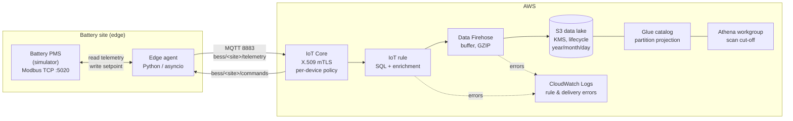

# BESS IoT Telemetry

Stream telemetry from a battery energy storage system (BESS) to an AWS data lake, and control it back from the cloud.

The project has three parts:
- a **Modbus TCP battery simulator**;
- a **Python edge agent** that publishes over **MQTT with mutual TLS** to **AWS IoT Core**;
- a **serverless ingestion pipeline** that lands the data in a KMS-encrypted S3 lake, where you can query it with **Athena**.

Everything is provisioned with **Terraform** and deployed by **GitHub Actions through OIDC**, with no long-lived AWS keys.

> Portfolio project. The battery is simulated, and so is all the data.

## Architecture



**Data flow**
1. The agent polls the PMS holding registers every few seconds. It decodes the scaled int16/uint16 values and publishes a versioned JSON payload with QoS 1.
2. An IoT Core rule enriches every message:
   - `topic_site_id` is the site ID taken from the topic. It can't be spoofed, because of the device policy (see below);
   - `ingested_at` is the time IoT Core received the message.

   The rule then forwards the message to Firehose.
3. Firehose buffers the messages and writes GZIP JSON lines to `s3://…/telemetry/year=/month=/day=/`, encrypted with a customer-managed KMS key.
4. Athena queries the data right away. Partition projection removes the need for crawlers or `MSCK REPAIR`.
5. Commands travel the other way. A JSON setpoint published on `bess/<site>/commands` is validated by the agent, written to the PMS over Modbus, then acknowledged on `bess/<site>/commands/ack`.

## What this project demonstrates

| Area | Implementation |
|---|---|
| **IoT security** | One X.509 certificate per device, issued from a **CSR**. The private key never leaves the device and never enters the Terraform state. A single IoT policy uses `${iot:Connection.Thing.ThingName}`, so each gateway can only connect as itself and use its own topics. |
| **Infrastructure as Code** | Terraform ≥ 1.10 with two reusable modules (`device_fleet`, `telemetry_lake`), a remote S3 state with native locking (`use_lockfile`), and a partial backend configuration: no account ID is committed. |
| **CI/CD** | GitHub Actions authenticates to AWS through **OIDC**. **Two roles:** a read-only `plan` role for pull requests, and a scoped `apply` role that only accepts tokens issued for the protected `production` environment. |
| **Least privilege** | The apply role is limited to resources named `bess-*`. It can only pass roles to `iot` and `firehose`, and an explicit deny stops it from editing its own roles. |
| **Data engineering** | A versioned payload contract, Glue schema, partition projection, an Athena workgroup with a per-query scan limit, and saved queries (latest state per site, hourly energy). |
| **Supply chain** | Trivy scans the Terraform and the image in CI. The image is multi-arch (amd64 + arm64) with an SBOM and build provenance attestation. Dependabot updates Actions, uv, Terraform and Docker. |
| **Software quality** | Typed Python 3.12, ruff, and pytest unit tests plus an **integration test against a real Modbus TCP server**. Commands are validated before they reach industrial equipment. |
| **Resilience** | QoS 1 with a bounded offline queue (paho), automatic MQTT and Modbus reconnection with backoff, and a graceful shutdown on SIGTERM. |

## Repository layout

```text
.
├── src/bess_telemetry/
│   ├── registers.py      # Modbus register map + int16/uint16 scaling
│   ├── battery.py        # battery physics: SoC, ramp rate, SoC limits, thermal
│   ├── simulator.py      # Modbus TCP server (bess-sim)
│   ├── agent.py          # edge agent (bess-agent)
│   ├── messages.py       # telemetry payload contract + command validation
│   └── config.py         # 12-factor configuration
├── tests/                # unit + Modbus integration tests
├── terraform/
│   ├── bootstrap/        # state bucket, GitHub OIDC provider, plan/apply roles
│   ├── modules/
│   │   ├── device_fleet/ # things, certificates from CSR, IoT policy
│   │   └── telemetry_lake/  # KMS, S3, Firehose, IoT rule, Glue, Athena
│   └── environments/dev.tfvars
├── devices/              # device CSRs (public). Private keys are git-ignored.
├── scripts/new-device.sh # generates key + CSR for a new site
├── compose.yaml          # local stack: simulator + agent + Mosquitto
└── .github/workflows/    # ci.yml, terraform.yml, release.yml
```

## Run locally (no AWS account needed)

```bash
docker compose up --build
```

In another terminal, watch the telemetry:

```bash
docker compose exec mosquitto mosquitto_sub -t 'bess/#' -v
```

Send a command to discharge at 500 kW. The power ramps up and the SoC starts to drop:

```bash
docker compose exec mosquitto mosquitto_pub -t bess/site-local-01/commands -m '{"command_id":"demo-1","setpoint_kw":500}'
```

Development without Docker:

```bash
uv sync
uv run pytest
uv run bess-sim &
SITE_ID=site-local-01 uv run bess-agent
```

## Deploy to AWS

**1. Bootstrap (once, with admin credentials)**

```bash
terraform -chdir=terraform/bootstrap init
terraform -chdir=terraform/bootstrap apply -var github_repository=<owner>/<repo>
```

**2. Configure GitHub**

- Repository variables: `AWS_REGION`, `TF_STATE_BUCKET`, `AWS_PLAN_ROLE_ARN` (taken from the bootstrap outputs).
- An environment named `production`, restricted to `main`, with required reviewers, and with the variable `AWS_APPLY_ROLE_ARN`.

**3. Register a device**

```bash
scripts/new-device.sh site-demo-01
```

This writes `devices/site-demo-01.key` (stays local) and `devices/site-demo-01.csr.pem` (to commit). Add the site to `terraform/environments/dev.tfvars`, then open a pull request: the plan shows up in the job summary. Once you merge and approve, the apply runs.

**4. Point the agent at AWS IoT Core**

```bash
terraform -chdir=terraform output -json device_certificates_pem | jq -r '.["site-demo-01"]' > devices/site-demo-01.crt
curl -so devices/AmazonRootCA1.pem https://www.amazontrust.com/repository/AmazonRootCA1.pem
```

Then run the agent with these variables:

```bash
SITE_ID=site-demo-01 \
MQTT_HOST=$(terraform -chdir=terraform output -raw iot_endpoint) MQTT_PORT=8883 MQTT_TLS=true \
MQTT_CA_PATH=devices/AmazonRootCA1.pem MQTT_CERT_PATH=devices/site-demo-01.crt MQTT_KEY_PATH=devices/site-demo-01.key \
uv run bess-agent
```

**5. Query the data** from the `bess-dev-telemetry` Athena workgroup:

```sql
SELECT topic_site_id, ts, soc_pct, active_power_kw, status
FROM bess_dev_telemetry.raw_telemetry
WHERE year = '2026' AND month = '10'
ORDER BY ingested_at DESC
LIMIT 20;
```

## Interfaces

**Telemetry**, published on `bess/<site_id>/telemetry` with QoS 1:

```json
{"schema_version":1,"site_id":"site-demo-01","ts":"2026-10-17T09:30:00.123Z",
 "soc_pct":61.4,"soh_pct":98.5,"active_power_kw":500.0,"reactive_power_kvar":25.0,
 "temperature_c":29.8,"dc_voltage_v":818.2,"status":2}
```

**Command**, sent on `bess/<site_id>/commands`. Power is positive when discharging:

```json
{"command_id":"c-123","setpoint_kw":-250}
```

**Acknowledgement**, returned on `bess/<site_id>/commands/ack`:

```json
{"command_id":"c-123","accepted":true,"reason":""}
```

**Modbus register map** (holding registers, unit 1):

| Addr | Name | Type | Scale | Unit |
|---|---|---|---|---|
| 0 | soc_pct | uint16 | 0.1 | % |
| 1 | soh_pct | uint16 | 0.1 | % |
| 2 | active_power_kw | int16 | 0.1 | kW |
| 3 | reactive_power_kvar | int16 | 0.1 | kvar |
| 4 | temperature_c | int16 | 0.1 | °C |
| 5 | dc_voltage_v | uint16 | 0.1 | V |
| 6 | status | uint16 | 1 | 0 idle, 1 charging, 2 discharging, 3 fault |
| 10 | setpoint_kw (RW) | int16 | 0.1 | kW |

## Cost

The stack is fully serverless: no NAT gateway, load balancer or always-on compute. One site publishing every 5 seconds sends about 520k messages a month. This should cost **a few dollars a month**, mostly the two KMS keys (about $1 each). IoT Core messaging, Firehose, S3 and Athena add only cents at this volume. Run `terraform destroy` on the main stack to remove it all; the bootstrap stays.

## Roadmap

- CloudWatch alarms (IoT rule failures, Firehose data freshness) wired to SNS
- Fleet provisioning by claim, or Just-in-Time Registration, for factory-installed gateways
- Convert to Parquet with Firehose record format conversion, or an Iceberg table
- IoT Device Defender audit and alerts on abnormal device behavior
- Pin GitHub Actions to commit SHAs

## License

MIT
